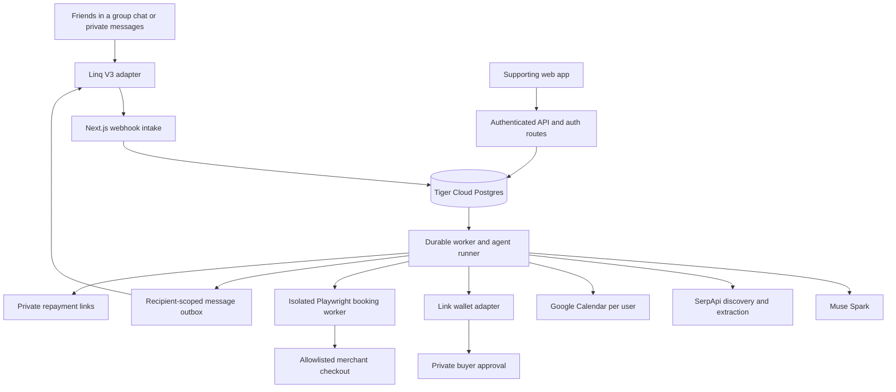
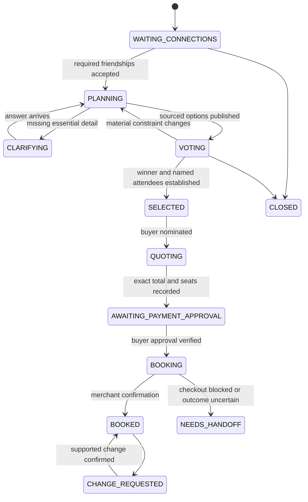

# Technical Architecture

Design baseline: October 24, 2026. Product behavior comes from [IDEA.md](IDEA.md). This is an implementation design based on primary documentation and the opening-ceremony slides, not a report of working integrations. No provider accounts were provisioned or charged during this research. See [SOURCES.md](SOURCES.md) for evidence and access limits, [CONTRACTS.md](CONTRACTS.md) for interfaces, and [IMPLEMENTATION_PLAN.md](IMPLEMENTATION_PLAN.md) for the four-person build order.

## 1. Decision

Build one TypeScript application with a web process, a durable background worker, and Postgres. Both messaging flows enter the same agent runner and plan state machine. Ship the movie journey first as the concrete example, while supporting broad local-outing requests through the same discovery tools.

| Layer | Selected implementation | Reason |
|---|---|---|
| Runtime and repo | Node.js 24 LTS; pnpm workspaces; TypeScript | One language and shared types across the team. Pin exact dependency versions and the container image during scaffolding. |
| Web | Next.js 16 App Router, React, Tailwind, shadcn/ui | Signup, friends, private settings, plan details, payment requests, and run inspector; Route Handlers serve the HTTP API. |
| Authentication | Better Auth phone-number plugin; OTP delivered privately through the messaging adapter | Phone login without requiring another paid auth/SMS vendor. |
| Main messaging | Linq V3 iMessage API; start on Hobby, use the free Pro trial only if needed | Test the actual account's DM/group/poll capabilities before choosing a tier. Hobby's contact capacity covers the team; group entitlement is the access question. |
| Messaging fallback | Telegram Bot API, only if Linq access fails | Free group discussions and polls, with explicit onboarding differences described below. Build one live adapter first. |
| Model | Meta Model API, `muse-spark-1.3`, Standard mode | Use the supplied Muse credits for extraction, tools, reasoning, and explanations. Keep the model ID configurable if the event key exposes a different Spark version. |
| Discovery | Supplied SerpApi account: Google Search/showtimes, Maps, Events, Extract | Real candidates and sources; no additional search vendor. |
| Data and queue | Tiger Cloud Postgres; Drizzle migrations + `pg`; SQL jobs and outbox | One database for identities, plans, durable work, and run history; no Redis or separate workflow service. |
| Hosting | Vultr VM using MLH credits; Docker Compose + Caddy | Persistent workers and Chromium fit a VM better than short-lived request functions. |
| Buyer wallet | Official Link Agent Wallet CLI behind a typed server adapter | Per-purchase approval and a payment credential; official multi-identity support. |
| Booking execution | Playwright in an isolated worker, one rehearsed merchant checkout | A bounded implementation of booking rather than an assumed public theater purchasing API. |
| Reimbursement | Private requests with the buyer's PayPal.Me amount links; exact ledger in Postgres | Works without inventing a Link peer-to-peer transfer API or routing friends' money through the team's merchant account. |
| Calendar | Google OAuth + Calendar free/busy; optional own-calendar event creation; ICS fallback | Each person authorizes their own access; calendar connection remains optional. |

Next supports self-hosting, and Better Auth documents phone OTP with a custom delivery function. These are the implementation bases, not claims that either hosts or sends messages for us. [Next hosting](https://nextjs.org/docs/app/guides/self-hosting), [phone auth](https://better-auth.com/docs/plugins/phone-number).

## 2. What is actually available

| Resource | Evidence status | Design consequence |
|---|---|---|
| SerpApi access and Muse credits | User-confirmed; quota, model entitlements, and keys not exercised here | Primary discovery and inference. Integration owner checks balances before testing. |
| Meta, SerpApi, Northmark challenges | Opening-ceremony pages 34, 47, 51 inspected, including rendered slides | Strong product fit for Meta/SerpApi. Northmark asks us to build reusable agent infrastructure; it is not a dependency on a Northmark API. |
| Tiger Data and Vultr | Listed on the official HackTX MLH prize hub; account redemption not tested | Use them where their access works. Do not assume an exact event-credit dollar amount. |
| Linq group support | Public docs and trial pricing verified; no team account test | First transport choice, conditional on a short real-device spike. |
| Link buyer spending | Public docs and official CLI verified; team onboarding not tested | Implement the typed wallet port and test flow; prove real account access before claiming live spending. |
| Theater purchases | AMC explicitly restricts seating/ecommerce access | No assumption that SerpApi + a key can purchase movie tickets through an open API. |
| Student benefits | Current GitHub Pack page checked | Azure credit is a hosting fallback; benefits are not assumed redeemed or transferable between teammates. |

The [MLH event hub](https://www.mlh.com/events/hacktx-26/prizes) confirms Tiger Data and Vultr categories. The local [opening slides](</Users/hrutvik/Downloads/HackTX 26 Opening Ceremony.pdf>) establish the other challenge descriptions. The similarly named Northmark AI website found in search is not evidence about Northmark Compute & Cloud.

## 3. Deployment shape



One Vultr instance initially runs `web`, `worker`, `booking-worker`, and `caddy`. Choose roughly 2 vCPU/4 GB RAM for headroom with Chromium; the actual instance price and available credit are checked in the account. Keep browser concurrency at one. Tiger Cloud is external over verified TLS. Local development uses a Docker Postgres container with the same schema. If Tiger provisioning is blocked, deploy ordinary Postgres in Compose with a persistent volume; the application only relies on standard Postgres features.

Do not introduce Kubernetes, microservice RPC, a vector database, a graph database, Redis, or a general multi-agent framework. Browser automation has its own process/container because it has different lifecycle and credential requirements, not because the product needs independently scaled services.

## 4. Repository and responsibilities

```text
apps/
  web/                    # Next UI, Route Handlers, Better Auth
  worker/                 # inbound processing, agent loop, jobs, outbox
  booking-worker/         # bounded Playwright checkout, trusted payment fill
packages/
  accounts/               # profile, session integration, friendship services
  contracts/              # Zod schemas, DTOs, provider-port types
  db/                     # Drizzle schema, SQL migrations, repositories
  core/                   # plan transitions, slots, votes, durable jobs
  agent/                  # Muse client, prompts, tool registry, context builders
  discovery/              # sourced candidate normalization and cache
  fulfillment/            # quotes, booking, split arithmetic, repayment services
  integrations/
    messaging/linq.ts
    messaging/telegram.ts # implement only after an actual fallback decision
    serpapi.ts
    google-calendar.ts
    link-wallet.ts
    reimbursements.ts
  templates/              # movie-night and local-outing configurations
infra/                    # Compose, Caddy, deploy/backup commands
```

Imports flow from apps to packages; the domain layer never imports a provider SDK. `contracts` and database migrations have one owner. The web app and messaging agent call the same core commands so a button click cannot bypass rules that chat must obey. The four independently selectable parts and exact file/route ownership are in [IMPLEMENTATION_PLAN.md](IMPLEMENTATION_PLAN.md); Part 2 owns shared contracts/schema, Part 1 owns the scaffold, Part 3 coordinates deployment, and Part 4 owns discovery/fulfillment.

## 5. Signup, identity, and friendships

1. Signup collects phone, name, city, interests. Normalize the phone to E.164 and resolve the city to a label, approximate centroid, and IANA time zone; show the resolved city to the user. Use the browser time zone as a hint, not proof of the city's zone. Austin's demo mapping is `America/Chicago`; ambiguous cities require a question.
2. Better Auth generates a six-digit OTP with a five-minute life. Its `sendOTP` callback puts a private verification message in the outbox for the claimed phone number; the code must never enter a group chat, model prompt, or run log. Limit attempts and resends, and use the library's verification/session flow. The required internal email field uses an opaque synthetic `.invalid` address; users supply no email for signup and that value is never used as a contact address.
3. A signed provider webhook establishes the sender's messaging handle. Link that handle to the verified account only after the phone verification/session flow; an iMessage email handle requires an explicit logged-in linking challenge rather than a name match.
4. Web sessions use Secure, HttpOnly cookies. Mutating endpoints require an authenticated session and same-origin/CSRF protection. Invite tokens identify a pending request; they never serve as permanent login credentials.
5. Look up names only among the organizer's accepted friends. For an unknown name, ask for the number, privately send the invitation, and resume the pending plan after signup and friend acceptance. Do not require a second enrollment approval from existing friends.
6. Store one friendship per unordered account pair with a pending/accepted state. The organizer must have an accepted connection to every named participant; participants need not form a clique. New connections are accepted by the invitee, not inferred from chat membership.

Better Auth supports phone-first signup through `signUpOnVerification` and a custom OTP sender. Its exact auth tables should be generated from the pinned library configuration, not independently reimplemented. [Phone plugin](https://better-auth.com/docs/plugins/phone-number).

If the transport cannot deliver an OTP to the phone, verification stays incomplete. In the Telegram fallback, `/start` first offers a private keyboard button that requests the sender's own contact. Require `contact.user_id == message.from.id`, normalize the phone, and record the authenticated phone-to-chat binding; reject forwarded contacts and typed numbers as proof. Better Auth's OTP sender then looks up that binding and delivers the login code to that private chat, so the same web session flow still applies. An invite must match the verified recipient's phone. Test this path against the pinned Telegram client/API before enabling it. Do not silently replace verification with an unverified profile field.

## 6. Messaging and the two entry flows

### Primary adapter: Linq V3

Start on Linq Hobby: the advertised 20-contact capacity covers the team and a small demo. Its page says full API access but also lists group messaging as a Pro addition, so test actual group/poll access rather than declaring Hobby insufficient. If a required feature is gated, try the advertised seven-day Pro trial; if neither usable tier supports the flow, use the transport fallback. Paid Pro starts at $260/month and is outside the team's budget. [Pricing](https://linqapp.com/s/pricing).

The group API documents creation through `POST /api/partner/v3/chats`, subsequent chat messages, and participant management. Initial chat creation must contain plain text without a link; send setup links afterward. Persist the provider chat ID. Native polls are created only in an existing chat, have add-only options, and support per-option votes. A changed plan gets a new poll; stale poll votes are ignored in our database. [Group API](https://docs.linqapp.com/channel/imessage/guides/chats/group-chats/), [poll API](https://docs.linqapp.com/channel/imessage/guides/messaging/polls/).

- Existing GC: accept the first signed inbound event after the agent is added, retrieve the current participant handles, identify the requester as organizer, and resolve the intended plan roster. Only context received after joining is assumed available. Ask for a short recap if earlier context is missing.
- Direct request: resolve the named friends and pending connections, generate options once connected, and create a group including the organizer and all named participants. Begin with a plain-text introduction, then send the options and poll. If group creation fails, keep a plan conversation per participant and send private options instead.
- Publish three short option explanations followed by a multi-selection poll for acceptable options. Collect the favorite with a short reply such as “favorite B” or the authenticated web control; do not pretend that a native poll has a second preference dimension.
- Map inbound votes to actual signed sender identities. The API's outbound vote method is not a way to impersonate participants.
- Ignore bot echoes/status events as conversation turns. Match replies to pending questions using `reply_to`/message IDs. When a DM could refer to several plans, ask which plan rather than applying a private change globally.

Pin the webhook version. Verify the raw body with the Linq SDK's Standard Webhooks support, reject old signatures, deduplicate provider event IDs, store the event durably, and return 2xx quickly. Linq documents at-least-once delivery; slow model calls belong in the worker. [Webhooks](https://docs.linqapp.com/channel/imessage/guides/webhooks/).

### Fallback: Telegram

Create a bot through BotFather; add it to a Telegram group and configure message access for the intended contextual discussion. Non-anonymous, multiple-answer polls capture acceptable options; replies or web controls capture favorites. Validate the webhook secret header and update ID. A user must start the bot before private messages can work. The Bot API does not provide a general create-group method: the organizer creates the group and adds the bot, or the existing private-request flow stays in DMs. Unknown phone contacts receive an organizer-shared deep link rather than an unsupported cold bot message. These are explicit differences from the primary flow. [Bot introduction](https://core.telegram.org/bots), [message visibility](https://core.telegram.org/bots/faq), [Bot API](https://core.telegram.org/bots/api).

Do not spend the weekend implementing WhatsApp onboarding or buying a production iMessage plan. Photon currently advertises full managed group access on its $250/line Business tier, and Sendblue limits outbound group creation by plan; their inexpensive/free DM tiers are not equivalent replacements. Self-hosted Mac bridges add a machine dependency and are not the default. [Photon pricing](https://photon.codes/pricing), [Sendblue groups](https://docs.sendblue.com/getting-started/groups).

## 7. Durable events and plan state

The webhook transaction inserts `inbound_events` and a `jobs` row with the same deduplication key. If the transaction fails, return a retryable error. Workers claim jobs with `FOR UPDATE SKIP LOCKED`, persist a lease, and commit before external calls; heartbeat long work. PostgreSQL explicitly supports this locking pattern for queue-like tables. [Postgres SELECT](https://www.postgresql.org/docs/current/sql-select.html).

Process one mutation stream per plan. Before calling an external tool, capture the plan's `input_revision`; before publishing results, compare-and-swap that revision. A reply arriving during a search makes the old draft obsolete rather than letting it overwrite newer constraints. Do not hold an SQL transaction open while waiting for a model, user approval, or browser session.



These are plan workflow states. Wallet state, merchant booking state, calendar sync state, and each reimbursement state are separate records. An approved wallet request is not a movie booking. A simulation uses an explicit test mode and never produces a live `BOOKED` claim.

Outgoing messages use a transactional outbox with recipient and idempotency keys. Retry provider operations only when safe; when an outbound result is ambiguous, reconcile the provider message/request ID before sending again. UI polls the authorized plan endpoint every two seconds while work is active; a websocket service is unnecessary. Keep one active plan per group conversation for the hackathon; DMs route by a pending question/reply or a short plan reference.

## 8. Agent architecture

Use one bounded runner with distinct tasks, not autonomous agents arguing with one another:

| Task | Inputs | Output |
|---|---|---|
| Route/extract | Signed sender, current public conversation or that person's DM, current plan summary | Intent, proposed fact updates, a question, or a requested core command |
| Plan | Request, normalized candidates, aggregated fit data | Three candidate-based options with tradeoffs and source references |
| Discuss/repair | Active version, new public messages or allowed private change result | Focused reply, revised options, or a proposed selection |
| Fulfill | Selected option, exact quote, authorized buyer, allowed booking actions | Provider action requests and user-visible status |

Use the official `openai` Node SDK solely as a client for Meta's base URL `https://api.meta.ai/v1`; this does not introduce OpenAI API charges. Use Muse Responses for tool loops and a separate JSON-schema extraction call for structured facts/plan drafts. The platform supports custom tools and structured output. [Meta quickstart](https://dev.meta.ai/docs/quickstart), [tools](https://dev.meta.ai/docs/tool-calling), [structured output](https://dev.meta.ai/docs/structured-output).

Set `tool_choice: "auto"`; Meta currently rejects forced/named tool choices. Code invokes mandatory validation and state transitions directly, rather than hoping a model calls a required tool. For loop replay use `store: false` plus intact encrypted reasoning items within the same authorized context; never reuse private reasoning in a public conversation. Persist application facts and summaries in our DB. [Tool constraints](https://dev.meta.ai/docs/cookbook/tool-function-calling), [Responses replay](https://dev.meta.ai/docs/protocols/responses).

Tool execution always receives an injected `ActorContext`; the model cannot supply its own user ID, access token, recipient identity, or buyer authorization. Start with 12 useful tools:

```text
resolve_friends       request_connection    read_plan
read_availability     discover_candidates  propose_options
ask_private_question  record_preference    select_option
quote_booking        request_buyer_approval check_fulfillment
```

Messaging, exact vote writes, booking submission, calendar writes, and reimbursement creation are core commands with typed arguments and permission checks. They may be requested through tools, but only code can authorize/execute them. The fulfillment worker uses its narrow booking port; the conversational model receives no arbitrary shell tool.

Per run: at most 8 model turns, 20 tool calls, 8 SerpApi requests, and roughly 20,000 input + 3,000 output tokens as a target; enforce measured usage across the whole run. Cap discovery parallelism at three. A normal message has a 60-second worker deadline; a purchase waits in durable states and resumes on separate jobs. A booking session has a 10-minute limit. On cap/timeout, send a useful status or question and persist progress.

### Privacy by construction

The private context builder can read only its owner's personal facts. The deterministic feasibility layer reads approved per-user constraints and produces candidate fit results. The public reply builder receives venue/showtime facts, aggregate fit, public conversation, and public decisions; it does not receive private budgets, raw interests, calendar titles, or private-message transcripts. A question to an individual is a recipient-scoped action. Run logs store tool names, timings, source IDs, and redacted outcomes, not private prompt text or card credentials.

Use Standard Muse mode for real users; Contributor mode permits model-training use. Public explanations never attribute private preferences. Free-tier Gemini, if added, receives only public options/synthetic test data. [Meta pricing/modes](https://dev.meta.ai/docs/pricing-rate-limits), [Gemini pricing](https://ai.google.dev/gemini-api/docs/pricing).

## 9. Calendar and availability

Use a Google Web OAuth client with exact local/deployed callback URLs. The signed OAuth state binds the connection to the authenticated account, with a one-time nonce; use the official `googleapis` library for the authorization-code exchange and refresh. Encrypt refresh tokens with an application key and delete them on disconnect. Request offline access and preserve an existing refresh token when a later grant omits one. [OAuth guide](https://developers.google.com/identity/protocols/oauth2/web-server).

Start with `calendar.events.freebusy` and the user's primary calendar. Call `POST /calendar/v3/freeBusy` under each participant's own token; the organizer's token does not magically grant access to friends' calendars. The response supplies busy intervals, not event titles. Private appointment follow-ups are driven by what someone has actually told the agent, not invented calendar details. Primary-only coverage is disclosed in settings. [Free/busy](https://developers.google.com/workspace/calendar/api/v3/reference/freebusy/query).

Store explicit chat availability with its author, plan, time range, provenance message, and confidence. Fresh explicit corrections supersede older statements. A conflict with a still-busy calendar prompts a private clarification; silence or a failed calendar query is never converted to known availability.

For each candidate interval, check intersection with every known busy interval and stated constraint. Include sourced runtime and a clearly labeled arrival/travel buffer; city alone cannot give a precise door-to-door commute. Unknown runtime makes the option tentative until clarified or sourced. Use UTC instants in storage, IANA zones for local display, and `[start,end)` interval comparisons. Do not estimate availability through the LLM when exact intervals are available.

At signup offer calendar connection; request write scope incrementally only when enabling Add to calendar. Create one event in each consenting user's own calendar using `calendar.events.owned`, with no attendee-email requirement. Derive a stable provider-valid event ID from plan/user and keep its provider ID for updates. Users without write access receive authenticated ICS downloads with stable UIDs. Calendar creation follows the group's selection and clearly reflects unbooked/test status when applicable. [Event insertion](https://developers.google.com/workspace/calendar/api/v3/reference/events/insert).

Use Google OAuth Testing mode and register the four teammates/testers explicitly. Public docs describe up to 100 test users and seven-day test authorizations. Standard Calendar usage is free within its quotas at this scale. No production-verification project is needed for the controlled demo. [Testing rules](https://support.google.com/cloud/answer/15549945), [Calendar quotas](https://developers.google.com/workspace/calendar/api/guides/quota).

## 10. SerpApi discovery and normalization

SerpApi is the live information layer. Muse decides what to search and how to explain the results; it is not replaced by the search API.

| Request | API use | Normalized output |
|---|---|---|
| Specific movie | `engine=google`, movie + city + requested date; inspect `showtimes` and organic results | Theater, date, screening time/format, address, source URL |
| Broad outing | `engine=google_maps` and/or `engine=google_events` | Real places/events, hours or event timing where supplied, URLs, price signals |
| Source detail | `engine=extract`, `url`, `mode=scrape` | Official-page runtime, price text, booking links, and restrictions if actually present |

The documented showtimes field is conditional on Google's result. Its theater link can be a Google search URL; it is not necessarily a merchant checkout URL. Neither its existence nor an Events/Maps result establishes ticket inventory, seats, or final pricing. [Showtimes](https://serpapi.com/showtimes-results), [Maps](https://serpapi.com/google-maps-api), [Events](https://serpapi.com/google-events-api), [Extract](https://serpapi.com/extract-api).

Normalize all results into the contract in `CONTRACTS.md`, including provenance per important field. Validate date/year and local time rather than parsing “Today” with the server's time zone. When Google returns the wrong movie or day, refine the query once, then explain the missing information. Never use the documentation's old example showtimes as live data.

Cache keys include engine, normalized query, city/location, requested date, language, and extraction URL. Use roughly 5 minutes for showtimes/events, 1 hour for place discovery, and 10 minutes for static extracted details. Recheck the actual merchant quote and seats immediately before authorization/purchase. Reuse candidates during a budget/time repair when possible instead of searching from scratch. Store fetched timestamps and source URLs; never log query-string API keys.

Generate up to 15 candidates, filter known conflicts in code, then select three useful alternatives with Muse. Options reference real candidate IDs. Price tiers are grounded in quoted/sourced prices; otherwise say price unknown or use a sourced format distinction without inventing a price. If a private maximum is supplied and costs are unknown, mark price fit unverified and resolve it at quote time. The model cannot invent a venue, booking URL, runtime, or cost to satisfy the requested option count.

## 11. Voting, selection, and repair

Votes are `(version, option, user)` records with separate acceptable and favorite fields. Favorites may be supplied through natural-language replies, but are applied only to the actual sender's record. An explicit objection is a separate fact. Unknown participants in a native chat cannot mutate an app plan's votes until linked.

Choose a provisional leader by acceptable count, then favorite count, respecting known hard constraints and objections. A real message saying to proceed plus the announced named attendees establishes the group decision; it may include silent holdouts when context supports that. If uncertain, ask “B leads. Book for Alex, Mark, and Mel?” once. Any participant can contribute; the organizer can resolve a preference tie when the group delegates it. No individual may change someone else's private constraint or approve their wallet.

On a material update, create a new immutable version and mark the old poll superseded. Announce the actual change and open a fresh poll or ask the focused question needed. A mere typo in explanatory prose does not invalidate a selection. A roster, seat, total, venue, time, or activity change invalidates the affected purchase quote/authorization binding. Changes after a confirmed booking go through the change workflow, not a second automatic purchase.

Schedule one reminder job 30 minutes after publishing a poll; its payload includes the version. If the version is obsolete or the group already decided, the job does nothing. Waiting for people does not hold a model/browser session open.

## 12. Booking, buyer wallet, and reimbursements

### Supported execution path

1. After selection, nominate the buyer and acquire a current merchant quote for the named attendees and seats. Record merchant host, screening, seat IDs, total/currency, expiration, and a hash of those details.
2. Show the exact purchase summary to the group and privately request the buyer's authorization. Link creates a purchase-specific approval URL and credential after approval; it does not select seats or place the theater order itself. Retrieve authoritative wallet state on resume rather than trusting a redirect. [Link spending guide](https://docs.stripe.com/agentic-commerce/agents/link-agent-wallet/use-link-wallet-pay-online).
3. Use the official CLI through `execFile` with a fixed command allowlist and argument arrays, never shell strings. Each linked buyer has a separate auth context via the documented `--auth` file override, encrypted at rest and materialized only in a private worker location. Prefer the official TypeScript SDK once the CLI spike works; do not invent OAuth endpoints. A user-link state/nonce binds the wallet connection to the logged-in app account. [Official Link CLI](https://github.com/stripe/link-cli).
4. Playwright navigates one rehearsed, allowlisted merchant checkout. Use deterministic locators for known fields and bounded Muse-assisted observation for selection/navigation. Do not assume the Meta computer-use recipe is a hosted browser service; we supply the browser and tools. [Meta recipe](https://dev.meta.ai/docs/cookbook/computer-use), [Playwright containers](https://playwright.dev/docs/docker).
5. Retrieve the purchase credential only in the trusted payment-fill routine. Do not include PAN/CVC in model prompts, screenshots, logs, database rows, or browser recordings. Fill payment fields programmatically; retain only provider request IDs and redacted metadata. Verify the quote binding immediately before the final action. Any changed total or seats requires a new user decision/authorization as appropriate.
6. A merchant confirmation/order reference proves booking. A wallet approval or even a card authorization does not. Persist confirmation before sending success messages, create reimbursements once, then offer calendar actions. If the final click times out, mark `outcome_unknown` and reconcile; never retry an uncertain purchase blindly.

The browser port has fixed tools for navigating the allowlisted checkout, reading a quote, choosing seats, and submitting an authorized quote. No general terminal, cookie export, credential dump, or arbitrary network tool is exposed to the planning agent. CAPTCHA/login/3DS or an unsupported checkout yields a buyer handoff, not a fake success. Browserbase is optional browser hosting, not another mandatory model provider. Use our unrecorded VM browser for credential fill; a managed-browser path is limited to discovery/quoting until its credential-recording controls are verified.

AMC's official access page says its ecommerce and seating APIs require specific approval and contracts and are not currently accepting requests through that site. The MVP therefore relies on a validated browser flow or buyer checkout handoff, not an assumed AMC ticket API. [AMC access](https://developers.amctheatres.com/GettingStarted/NewVendorRequest).

### Bill splitting that can ship

After a confirmed purchase, calculate integer-cent shares in code. Assign individual ticket costs directly, allocate shared fees/discounts by subtotal using largest-remainder rounding, and verify that the shares equal the actual total. With equal tickets this is an equal split. A buyer's own share is not a reimbursement request to themselves.

Ask the nominated buyer for a PayPal.Me handle if they want actionable reimbursement links; this is optional at purchase time, not another signup field. Generate `https://paypal.me/{handle}/{amount}USD` for each nonbuyer and send it privately with their share. PayPal documents amount/currency links. This is an automatically calculated, privately delivered payment request; it is not an automatic debit or verified repayment webhook. [PayPal.Me](https://www.paypal.com/us/cshelp/article/paypalme-frequently-asked-questions-help432).

Use `requested`, `payer_reported_sent`, and `buyer_confirmed_received` statuses. The buyer can confirm receipt in chat or the authenticated web view. Do not label a manual acknowledgment as provider-verified. A user-supplied alternate payment link/manual settlement remains possible if they have no PayPal.Me handle. Never use the team's Stripe merchant account to impersonate personal reimbursements. Linq's Stripe collection and Agentcard spending products describe different money directions, not an automatic peer-to-peer split rail. [Linq provider distinction](https://docs.linqapp.com/channel/imessage/guides/agentcard/agentcard-vs-stripe/).

### Development and fallback

Use Link test mode and an explicitly labeled owned checkout fixture for purchase tests. Test credentials do not pay for real theater tickets. Real SerpApi candidates plus a simulated checkout must say “Test booking,” retain their source lineage, and never produce live reservation claims. Real ticket costs are separate from the $40 API/infrastructure budget and require a buyer's purchase authorization.

For the live product demo, rehearse one merchant flow to a quote and establish whether authorization and purchase can complete. If not, preserve all planning/voting/splitting work and hand the buyer the actual merchant URL. The buyer can then report the completed purchase with a total and order reference; store `buyer_reported`, display “Buyer reports booked,” and generate shares from that reported total. It is never labeled provider-verified. Without such a report or merchant confirmation, external booking stays pending. Cancel/refund changes use the provider's supported process, with manual handoff when needed; do not build a custom refund engine.

## 13. Web screens and permissions

| Route | Audience and purpose |
|---|---|
| `/signup`, `/login` | Phone verification, name/city/interests, optional Calendar connection |
| `/friends` | Own connections and pending requests |
| `/invite/:token` | Intended recipient verifies identity and accepts the connection |
| `/plans` | Only plans visible to the session's account |
| `/plans/:id` | Public plan projection, options, current version, votes, group status, sources |
| `/plans/:id/private` | Own follow-ups, personal constraints, calendar settings |
| `/plans/:id/payment` | Own wallet approval/share; buyer sees their purchase and repayment ledger |
| `/studio` | Team-only templates, redacted run history, health/cost indicators |

All sensitive pages and API responses are dynamic and `Cache-Control: private, no-store`. Membership is checked on every plan request. Return a public projection by default; private columns are excluded server-side, not hidden by React. Polling endpoints return the current version and changes, never raw OAuth/wallet data. Access-denied responses do not reveal whether an arbitrary phone has an account.

## 14. Reusable runner and sponsor use

The agent runner loads a versioned template containing a system instruction, Muse model ID, allowed tool names, planning schema, max turns/searches, and task defaults. Ship `movie-night` and `local-outing` using the same runner. `/studio` shows the configuration plus actual runs, tool timing, sources, repairs, and redacted failures. This is a concrete interpretation of the Northmark platform challenge, without adding a second agent backend.

Muse and SerpApi are in the critical path. Tiger Data stores actual state/run events; Vultr hosts the live application. Optional Gemini critiques the public candidate set and returns a visible structured concern; code remains the feasibility authority. Voice input or a generated invitation card can be added after both journeys work. Defer Facebook Graph enrichment, Solana receipts, and Snowflake analytics: none is needed to make the core journey work. The MLH hub establishes available categories, not guaranteed team credits or automatic prize eligibility. [Event hub](https://www.mlh.com/events/hacktx-26/prizes).

## 15. Cash budget and cost controls

Team ceiling: $40 total, funded by contributions of up to $10 from each teammate. This is a pooled spending allocation, not a quote that every untested account will activate immediately.

| Item | Planned cash | Boundary |
|---|---:|---|
| Muse | $0 from supplied credits | Track actual token usage; reserve up to $5 only if credits fail/run out. |
| SerpApi | $0 from supplied access | Check remaining quota using Account API; cache/bound searches; no new paid subscription planned. |
| Tiger Cloud | $0 on advertised 30-day trial/event access | Paid service starts at $30/month; move to local/self-hosted Postgres if unavailable. |
| Vultr | $0 if MLH credit redeemed | Reserve up to $5 for short-lived hosting if necessary; inspect the account's actual minimum charge first. |
| Linq | $0 through Hobby if its required calls work; otherwise the free Pro trial | Start Hobby-first. No $260 production subscription within this budget; switch transports if free access cannot support the flow. |
| Link wallet | No paid developer subscription planned; development uses test mode | Account eligibility and any live fees must be checked; any extra API fee comes from the reserve, not an assumed grant. |
| Auth, Calendar, splits | $0 additional API line item in the planned path | Messaging delivers OTPs; calendar usage stays small; repayment links do not imply fee-free transfers. |
| Browser | $0 on our VM; optional Browserbase $20 Developer month | Browserbase Free advertises 1 hour/15-minute sessions; use that first if needed. No separate browser-model spend. |
| Contingency | $10 | Unallocated reserve. |
| Maximum allocated | **$40** | $20 browser + $5 hosting + $5 model + $10 reserve. Free-plan resources should keep actual spend lower. |

At published Muse Standard rates, 20k input and 3k output tokens cost approximately $0.03775 per run before any cache discount; 100 such runs cost $3.775. This is an illustrative workload, not a measured run cost or permission to exceed credits. Planning without built-in Muse web search avoids duplicate search billing. Use supplied SerpApi quota and its Account API rather than guessing the sponsor allowance. [Muse rates](https://dev.meta.ai/docs/pricing-rate-limits), [SerpApi account](https://serpapi.com/account-api).

Tiger advertises a 30-day trial and hourly billing. Vultr confirms MLH cloud credits but the public page does not state this team's grant. Browserbase lists Free and $20 Developer plans. [Tiger pricing](https://www.tigerdata.com/pricing), [Vultr MLH](https://discover.vultr.com/mlh), [Browserbase pricing](https://www.browserbase.com/pricing).

The current GitHub Student Pack lists $100 Azure credit, Clerk Pro, Appwrite Education, and $25 Stripe credits toward product fees. Azure is the backup host if already activated; we do not add Clerk/Appwrite on top of the chosen stack. Stripe fee credit is not cash for tickets or confirmation of wallet eligibility. Do not budget unverified historical Twilio/DigitalOcean Pack offers, or pool four personal education credits as one balance. Student approval timing is not a dependency for the overnight build. [Current Pack](https://education.github.com/pack).

Persist usage per run/provider, with reserved estimated cost before expensive work and actual cost afterward. Allow up to 200 SerpApi requests for the initial build/demo only if the account's real remaining quota covers it; otherwise lower the cap. Stop new paid work at configured cash envelopes and leave existing results usable. Record trial expiration and resource teardown owners in the implementation checklist.

## 16. Reliability, validation, and release criteria

Use structured logs keyed by plan/version/run/job/provider request ID, with secret/phone/private-text redaction. `/health/live` checks the process; `/health/ready` checks DB reachability and migrations. Studio shows provider configured/tested/degraded, last error, balances where queryable, and test/live modes. Do not make every health request call paid APIs.

Required focused checks:

- Duplicate signed webhooks produce one domain action; forged events are rejected.
- Name resolution uses accepted friendships; an invite token cannot claim another phone.
- A private budget/appointment marker never appears in public payloads, model context, logs, or messages.
- A new constraint arriving during planning prevents publishing the obsolete draft; stale poll votes cannot select the new version.
- Availability handles interval boundaries and the outing's time zone; failed free/busy access remains unknown.
- Shares sum exactly to the charged total with unequal items, discounts, and odd cents.
- Changed quote/attendees invalidate buyer authorization; uncertain booking outcome cannot trigger a duplicate purchase.
- Wallet/test approval, merchant confirmation, manual reimbursement acknowledgment, and calendar sync remain distinct.
- Both entry flows run on real devices through the same backend, with at least one unknown friend, one private follow-up, and one plan repair across the demo set.

Use Vitest for these domain/integration-boundary checks and Playwright for signup/plan/payment views. Capture sanitized fixtures from real provider responses once access is available. Test money stays in test mode until an actual buyer explicitly authorizes a real purchase. Record a working screen capture before optional sponsor additions. Implementation is complete when the vertical slice works and every unimplemented provider action has an honest, usable handoff.
